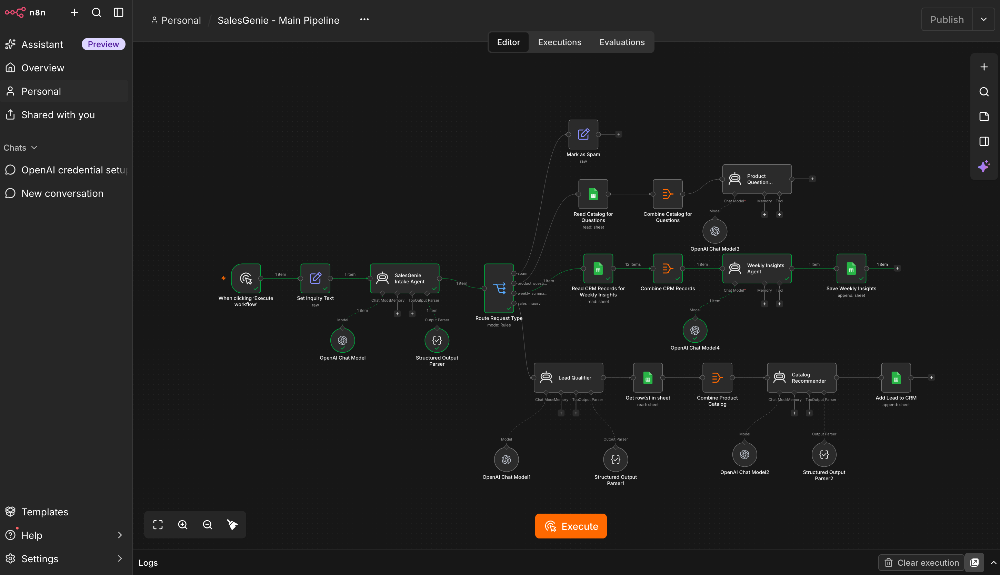

# SalesGenie: AI-Powered Sales Assistant

SalesGenie is an n8n workflow built for **Oak & Ember Interiors**, a home and office furniture retailer. It analyzes customer inquiries, qualifies sales leads, recommends catalog products, saves leads to Google Sheets, and generates CRM summaries.

## Workflow Download

[Download the workflow JSON](screenshots/SalesGenie%20-%20Main%20Pipeline%20-%20GitHub.json)

Open the file and select **Download raw file** to save it to your computer.

## Implemented Features

- Extract customer details, product interests, quantity, budget, urgency, and requirements.
- Route requests into four categories: sales inquiry, product question, spam, and weekly summary.
- Classify sales leads as **Hot**, **Warm**, or **Cold**.
- Generate product recommendations using the supplied catalog.
- Answer product questions using catalog information.
- Append sales leads and recommendations to Google Sheets.
- Generate CRM summaries and save them to a separate sheet.
- Mark spam without creating a CRM record.

Product availability and budget rules are included in the AI prompts. AI-generated results should be reviewed for accuracy.

## Workflow Architecture

```text
Manual Trigger
    ↓
Set Inquiry Text
    ↓
SalesGenie Intake Agent
    ↓
Route Request Type
    ├── Spam
    │     └── Mark as Spam
    │
    ├── Product Question
    │     └── Read Catalog → Combine Catalog → Answer Question
    │
    ├── Weekly Summary
    │     └── Read CRM → Combine Records → Generate Summary
    │           └── Save Weekly Insights
    │
    └── Sales Inquiry
          └── Qualify Lead → Read Catalog → Combine Catalog
                └── Recommend Products → Add Lead to CRM
```

## Repository Contents

- `data/product_catalog.csv` — Product catalog.
- `data/crm_export_sample.csv` — Sample CRM data.
- `data/eval_salesgenie_inputs.txt` — Example inputs for evaluation.
- `screenshots/` — Workflow screenshots and the current workflow JSON export.
- `README.md` — Project overview and setup instructions.

## Requirements

- An n8n instance supporting the nodes in the exported workflow.
- OpenAI credentials with access to the configured model, or another compatible model selected in each OpenAI Chat Model node.
- Google Sheets credentials with access to your catalog and CRM spreadsheets.

Model usage may incur API charges.

## Import and Setup

1. Download the workflow JSON linked above.
2. Open a new workflow in n8n.
3. Open the **three-dot menu (⋯)** and select **Import from File**.
4. Select the downloaded JSON file.
5. Configure credentials in all five **OpenAI Chat Model** nodes.
6. Configure Google Sheets credentials in every **Google Sheets** node.
7. Replace the spreadsheet placeholders by selecting your own spreadsheets:
   - `YOUR_PRODUCT_CATALOG_SPREADSHEET_ID`
   - `YOUR_CRM_SPREADSHEET_ID`
8. Select the appropriate sheet tab in each Google Sheets node.
9. Refresh and verify the column mappings in **Add Lead to CRM** and **Save Weekly Insights**.
10. Save the workflow.

Credentials are not included in the shared workflow. Each user must configure their own connections.

## Google Sheets Setup

### Product Catalog

Import `data/product_catalog.csv` into a Google Sheets spreadsheet and preserve its column headers.

Select this spreadsheet and its catalog tab in:

- **Get row(s) in sheet**
- **Read Catalog for Questions**

### CRM Leads

Create a tab named `CRM Leads` with these column headers:

```text
lead_id
customer_name
email
company
lead_tier
product_interest
budget
urgency
source
date_received
status
assigned_to
notes
```

Select this tab in:

- **Add Lead to CRM**
- **Read CRM Records for Weekly Insights**

The `notes` column stores the product recommendations as JSON text.

### Weekly Insights

Create a tab named `Weekly Insights` with these column headers:

```text
generated_at
weekly_summary
```

Select this tab in **Save Weekly Insights**.

**Mapping correction:** The current export contains a leading space in the mapped field ` weekly_summary`. Refresh the columns and map the agent’s output to `weekly_summary` without a leading space.

## Running the Workflow

1. Open **Set Inquiry Text**.
2. Replace the `inquiry_text` value with a test request.
3. Click **Execute workflow**.
4. Review the route selected and the output of each relevant node.
5. For sales inquiries and summary requests, verify the resulting Google Sheets row.

The default input is `Generate weekly summary`.

### Example Test Inputs

| Request type | Example input | Expected route |
|---|---|---|
| Sales inquiry | I need one standing desk for my home office. My total budget is $800. My name is Alex Demo and my email is alex@example.com. | Lead qualification → recommendations → CRM |
| Product question | Which products in your catalog are available in dark walnut? | Catalog question responder |
| Spam | Buy website traffic now! Limited-time promotion! | Mark as Spam |
| Weekly summary | Generate weekly summary | CRM summary → Weekly Insights sheet |

These examples are for manual testing. Classification and generated responses may vary.

## Current Limitations

- The workflow uses a **manual trigger** and a manually entered inquiry. Email, form, and webhook intake are not configured.
- The “weekly summary” branch currently reads all available CRM rows. Add a date filter before the summary agent to restrict reporting to a specific week.
- There is no scheduled weekly execution.
- Product answers remain in the n8n execution output; customer messages are not sent automatically.
- Repeated sales-inquiry tests can append duplicate leads because deduplication is not implemented.
- Budget and stock rules rely on AI prompts rather than deterministic validation.
- The shared export requires credentials, spreadsheet selection, and column mapping before use.
- End-to-end operation must be verified in the importing n8n environment.

## Planned Improvements

- Automatic intake from email, forms, or webhooks.
- Personalized sales-response drafting.
- Competitive positioning.
- Date-filtered, scheduled weekly reports.
- Lead deduplication.
- Automated evaluation and execution tracing.
- Deterministic validation of product prices, stock, and budget constraints.

## Workflow Screenshot



This screenshot shows an earlier development stage and may differ from the exported main pipeline.

## Sharing and Security

The shared JSON has been cleaned of credential references, original spreadsheet IDs and URLs, and instance metadata. The sample email uses an example address.

Before publishing future exports, review them for hardcoded API keys, authentication headers, private customer data, and pinned execution data.

## Author

Pankaj Shukla
